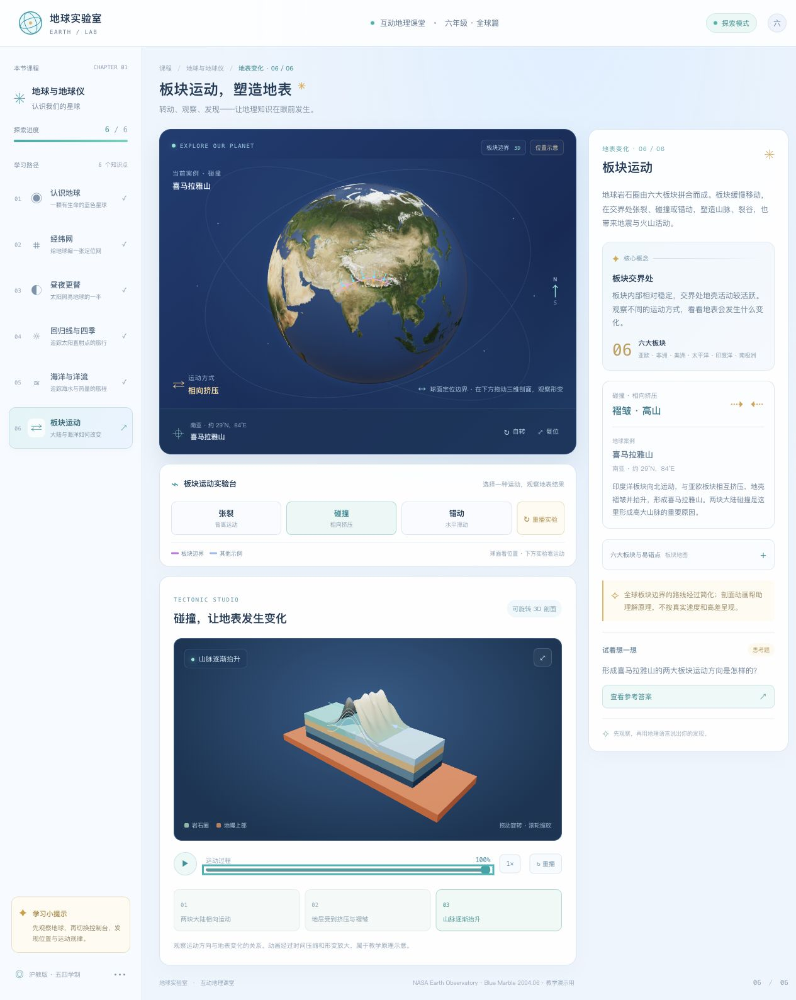

# 🌍 地球实验室 · 六年级地理互动课堂

面向上海初中六年级（沪教版五四学制）的交互式地理课堂原型。学生可以旋转使用卫星影像合成贴图的 3D 地球，切换地图图层、拖动时间轴、观察洋流与板块运动，并通过思考题检查理解。

> 当前项目专注于“地球与地球仪”相关的六个互动知识点。`knowledge/` 目录还包含更广的教材知识梳理；目录中提到的其他专题尚未全部实现。



## 目录

- [功能一览](#功能一览)
- [六个互动知识点](#六个互动知识点)
- [快速开始](#快速开始)
- [技术栈](#技术栈)
- [项目结构](#项目结构)
- [素材、数据与教学说明](#素材数据与教学说明)
- [后续方向](#后续方向)

## 功能一览

- **可交互的 3D 地球**：拖动旋转、滚轮缩放、自动旋转与复位；点击球面读取纬度和经度。
- **卫星地球材质**：保留 NASA Blue Marble 全球影像，增加地形凹凸细节、海陆分区反光和可开关的半透明云层；海水蓝色经过适度提亮，灯光随观察视角调整。昼夜课程单独使用太阳方向光。
- **地图图层控制**：按课程显示经纬网、赤道、南北回归线、极圈、地轴、晨昏线和太阳直射点。
- **时间与日期模拟**：拖动模拟时刻，观察昼夜明暗变化；拖动日期，追踪太阳直射点在南北回归线之间移动。
- **洋流动态展示**：8 个洋流案例，连续流线、方向箭头和发光粒子拖尾，支持暖流/寒流筛选、暂停及 0.5× / 1× / 2× 倍速。球面路线与下方海水输送、秘鲁沿岸上涌演示联动。
- **板块运动实验**：在地球上观察边界与运动箭头，在独立的三维实验中旋转、缩放分层岩石模型。支持张裂、碰撞、错动，播放/暂停、进度拖动、1× / 2× 倍速与重播；滚动到实验区域才开始播放。
- **观察题与参考答案**：每课配有问题提示和可展开的参考答案。
- **明亮课堂界面**：浅冰蓝背景、白色知识卡片与蓝色地球舞台，兼顾投屏讲解和个人探索；课程导航、场景及演示控件随屏幕宽度调整。

## 六个互动知识点

| 课程 | 主要内容 | 可操作的互动 |
| --- | --- | --- |
| **01 认识地球** | 地球形状、海洋与陆地分布 | 旋转地球、缩放观察、点击读取坐标 |
| **02 经纬网** | 经线、纬线与经纬度定位 | 开关经纬网，点击地球练习读取坐标 |
| **03 昼夜更替** | 太阳照亮地球的一半，地球自转带来昼夜更替 | 拖动模拟时刻，观察昼夜界线变化 |
| **04 回归线与四季** | 地轴倾斜与地球公转、太阳直射点移动 | 拖动日期，观察直射纬度与轨道位置 |
| **05 海洋与洋流** | 暖流、寒流及主要海流方向 | 筛选暖流/寒流、暂停与调速；观察海水输送、深层冷水上涌及案例联动 |
| **06 板块运动** | 张裂、碰撞、错动及其地表影响 | 定位三个典型边界；旋转三维剖面、拖动进度，观察裂谷、山脉和断层 |

## 快速开始

### 环境要求

- Node.js 18 或更新版本
- npm
- 支持 WebGL 的现代桌面或移动浏览器

### 安装与启动

先将示例地址替换为你上传后的 GitHub 用户名和仓库名，然后克隆项目：

```bash
git clone https://github.com/your-name/earth-course.git
cd earth-course
npm ci
npm run dev
```

启动后，打开终端输出的本地地址（Vite 默认通常为 <http://localhost:5173/>）。

### 构建与本地预览

```bash
npm run build
npm run preview
```

生产文件会输出到 `dist/`。`npm run preview` 用于本地检查构建结果；部署到静态托管服务时，请将 `dist/` 作为发布目录。

## 技术栈

- [Vue 3](https://vuejs.org/)：课程状态、交互界面与响应式内容。
- [globe.gl](https://globe.gl/)：地球渲染、球面路径、视角控制与交互。
- [Three.js](https://threejs.org/)：物理地球材质、环境反光、球面粒子、板块三维剖面与视角控制。
- [Vite](https://vite.dev/)：本地开发服务器与生产构建。
- SVG + 原生 CSS：洋流机制动画、课堂界面与响应式布局。

项目不需要地图服务密钥或后端服务。地球纹理和课程内容随仓库提供；开发时安装 npm 依赖后即可运行。

## 项目结构

```text
earth-course/
├── knowledge/                       # 沪教版五四学制地理知识梳理
│   ├── 00-总纲-沪教版五四制.md
│   ├── 01-六年级上册.md
│   ├── 02-六年级下册.md
│   └── 03-核心概念与易错点.md
├── public/
│   └── earth/
│       ├── blue-marble-june.jpg      # NASA 卫星合成影像
│       ├── earth-topology.png        # 地形凹凸纹理
│       ├── earth-water.png           # 海陆材质遮罩
│       ├── earth-clouds.png          # 云层纹理
│       └── SOURCES.md                # 素材来源说明
├── src/
│   ├── App.vue                       # 课程内容、状态与地球交互
│   ├── components/
│   │   ├── OceanLab.vue              # 海水输送与沿岸上涌演示
│   │   └── PlateLab.vue              # 可旋转、可拖动进度的板块三维实验
│   ├── scene/
│   │   └── globeEffects.js           # 地球材质、云层、洋流粒子与板块箭头
│   ├── main.js                       # Vue 应用入口
│   └── style.css                     # 页面与动画样式
├── index.html
├── package.json
├── package-lock.json
└── vite.config.js
```

## 素材、数据与教学说明

- **地球纹理**：使用 NASA Earth Observatory 的 [Blue Marble: Next Generation](https://science.nasa.gov/earth/earth-observatory/blue-marble-next-generation/) 2004 年 6 月全球合成影像。项目中的纹理为 `5400 × 2700` 全球图；它是月度合成影像，不是实时卫星画面。页面页脚保留来源说明。
- **辅助材质**：地形、海陆遮罩和云层来自 [three-globe 官方示例](https://github.com/vasturiano/three-globe/tree/master/example)。完整文件来源见 [`public/earth/SOURCES.md`](public/earth/SOURCES.md)。凹凸、反光和云层用于视觉表现，不是实时气象或可测量的高程模型。
- **洋流案例**：洋流概念参考 [NOAA National Ocean Service 洋流教学资料](https://oceanservice.noaa.gov/education/tutorial_currents/04currents3.html)。沿岸上涌参考 [NOAA 上涌说明](https://oceanservice.noaa.gov/facts/upwelling.html)。页面中的洋流路线和流动动画是课堂方向示意，不是实时海流数据。
- **板块案例**：运动类型参考 [USGS 板块构造教学资料](https://www.usgs.gov/educational-resources/plate-tectonics)；喜马拉雅山案例参考 [USGS《The Himalayas》](https://pubs.usgs.gov/gip/dynamic/himalaya.html)。页面中的边界路线经过简化，三维剖面动画不按真实速度、距离或高差比例呈现。碰撞实验展示两块大陆挤压抬升，不代表所有汇聚边界；张裂实验简化展示裂隙、岩浆与新地壳。
- **课程内容**：根据仓库 `knowledge/` 中的六年级教材知识点整理。当前界面只实现上表所列的六课，并非教材全册数字化版本。
- **地图用途**：地球和路径用于课堂观察与概念演示，不用于导航、测量或替代正式地图产品。

## 课堂使用建议

1. **先看位置**：旋转地球，选择洋流或板块案例，描述它位于哪个大洲、哪个大洋附近。
2. **再看方向**：沿移动箭头观察洋流，或对比板块两侧的运动方向。
3. **放大看过程**：向下滚动到机制演示；洋流可切换海水输送与沿岸上涌，板块可暂停或拖动进度。
4. **用语言解释**：结合右侧案例和思考题，说出“运动方向—发生的变化—地理影响”。

较老设备如果渲染吃力，可关闭云层、停止自动旋转。所有地球素材都在仓库本地，页面运行不依赖在线纹理服务。

## 后续方向

- 扩展海陆分布、海底地形、地形与河流等互动专题。
- 增加地图判读练习、闯关题和学习进度记录。
- 继续补充符合上海六年级教学情境的案例与本地地理内容。

## 许可说明

当前仓库尚未添加项目代码的 `LICENSE` 文件。若希望其他人按明确条件使用或修改代码，请在 GitHub 仓库中选择并添加合适的开源许可证。地球纹理等第三方素材请同时遵循各自来源页面的使用与署名要求。
